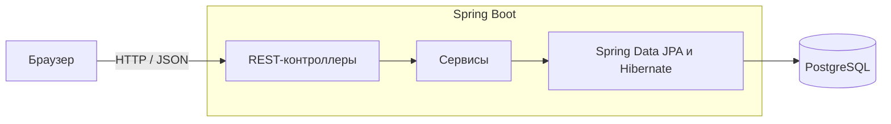
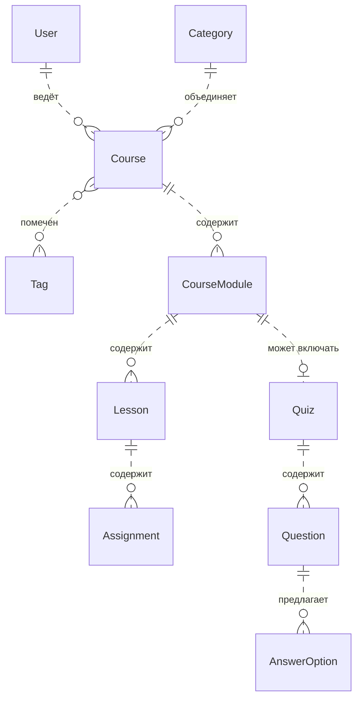
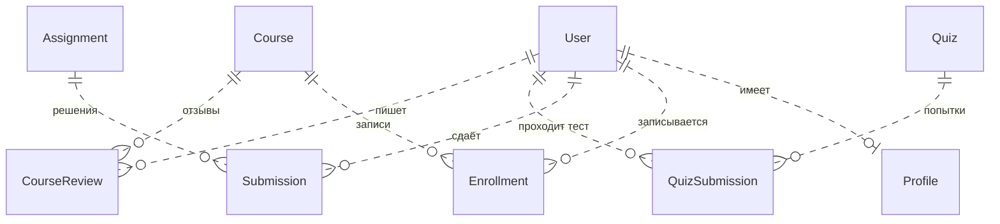

# Учебная платформа по ORM

Проект выполнил: Ярцев Владислав

## Запуск

Для запуска нужен Docker с Compose. Если файла `.env` ещё нет, скопируйте настройки из примера.

```bash
cp .env.example .env
docker compose --profile app up --build -d
```

С настройками из примера сайт откроется на [localhost:8081](http://localhost:8081). При первом запуске на пустой базе появятся демоданные. Выберите «Студент для проверки», откройте «Основы Hibernate» и сдайте задание. Для оценки работы выберите «Ведущий курса» и откройте «Проверить решения».

Команда `docker compose --profile app down` остановит приложение и базу. Для запуска через Maven есть [инструкция](docs/verification.md#запуск-из-исходников).

## Архитектура

Приложение на Java 17 и Spring Boot отдаёт страницу и обслуживает REST API. При сдаче работы `SubmissionService` проверяет активную запись на курс и срок сдачи, затем сохраняет решение.



## Связи сущностей

### Курсы и материалы



### Студенты и результаты



`Enrollment` хранит дату и статус записи студента на курс. Студент может сдать задание один раз. Для теста сохраняется каждая попытка. Связь курсов с тегами хранится в таблице `course_tags`. Загрузка связей и каскадное удаление подробнее разобраны в [описании модели](docs/architecture.md).

## Проверка

```bash
./mvnw verify
```

Команда запускает Checkstyle и тесты, затем собирает JAR. Для интеграционных тестов нужен Docker. Testcontainers поднимает отдельную PostgreSQL.

[Справочник REST API](docs/api.md) · [Примеры запросов](requests.http) · [Отчёт о проверке](docs/verification.md)
