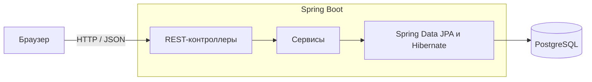
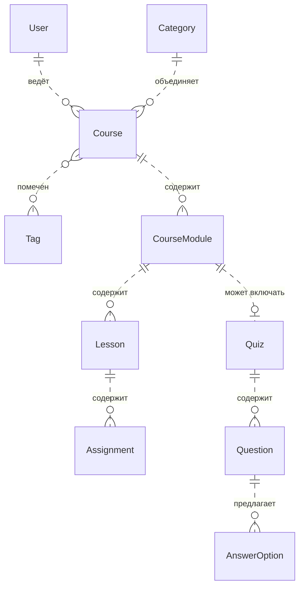
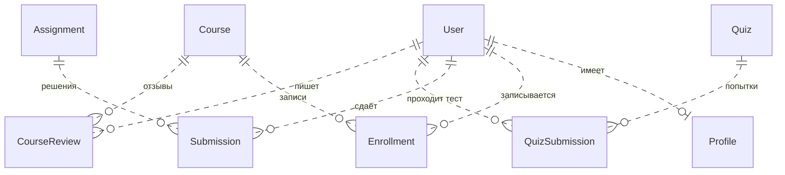

# Учебная платформа по ORM

Проект выполнил: Ярцев Владислав

## Запуск

Для запуска нужен Docker с Compose. Maven скачивает библиотеки, перечисленные в `pom.xml`, при сборке. В новой копии репозитория нужно создать `.env` из примера.

```bash
git clone https://github.com/st0mb1e/orm-learning-platform.git
cd orm-learning-platform
cp .env.example .env
docker compose --profile app up --build -d
```

С настройками из примера приложение доступно на [localhost:8081](http://localhost:8081). При первом запуске на пустой базе появятся два курса, преподаватель и два студента.

В поле «Участник демонстрации» нужно выбрать «Студент для проверки». Он уже записан на «Основы Hibernate». В первом модуле можно сдать задание и пройти тест. В роли «Ведущий курса» решение открывается через кнопку «Проверить решения». После проверки оценка появится у студента.

Команда `docker compose --profile app down` остановит приложение и базу. Для запуска через Maven есть [инструкция](docs/verification.md#запуск-из-исходников).

## REST API

| Что можно сделать | Основные запросы |
|---|---|
| Получить список пользователей или обновить профиль | `GET /api/users`, `PUT /api/users/{id}/profile` |
| Получить категории и теги | `GET /api/categories`, `GET /api/tags` |
| Найти, открыть или создать курс | `GET /api/courses`, `GET /api/courses/{id}`, `POST /api/courses` |
| Добавить модуль, урок или задание | `POST /api/courses/{id}/modules`, `POST /api/modules/{id}/lessons`, `POST /api/lessons/{id}/assignments` |
| Записаться, посмотреть список студентов или отписаться | `POST /api/courses/{id}/enrollments`, `GET /api/courses/{id}/students`, `DELETE /api/courses/{id}/students/{studentId}` |
| Сдать или оценить работу | `POST /api/assignments/{id}/submissions`, `PATCH /api/submissions/{id}/grade` |
| Открыть тест, отправить ответы или посмотреть результаты | `GET /api/quizzes/{id}`, `POST /api/quizzes/{id}/submissions`, `GET /api/users/{id}/quiz-results` |
| Посмотреть или оставить отзыв | `GET /api/courses/{id}/reviews`, `POST /api/courses/{id}/reviews` |

Полный список маршрутов, форматы JSON и коды ошибок есть в [справочнике API](docs/api.md). Примеры вызовов собраны в [requests.http](requests.http).

## Архитектура

Приложение на Java 17 и Spring Boot отдаёт страницу и обслуживает REST API. При сдаче работы `SubmissionService` проверяет активную запись на курс и срок сдачи, затем сохраняет решение.



### Структура проекта

```text
src/main/java/ru/mifi/platform/
├── web/          контроллеры и обработка ошибок
├── dto/          запросы и ответы API
├── service/      правила записи, сдачи и проверки работ
├── model/        JPA-сущности
├── repository/   запросы к базе
└── config/       начальное заполнение базы
src/main/resources/static/   интерфейс
src/test/                    юнит- и интеграционные тесты
docs/                        модель, API и результаты проверки
```

[Назначение сервисов и остальных слоёв](docs/architecture.md#сервисные-модули)

## Связи сущностей

В модели 15 JPA-сущностей. У каждой есть репозиторий Spring Data JPA.

### Курсы и материалы



### Студенты и результаты



`Enrollment` хранит дату и статус записи студента на курс. Студент может сдать задание один раз. Для теста сохраняется каждая попытка. Связь курсов с тегами хранится в таблице `course_tags`. Загрузка связей и каскадное удаление подробнее разобраны в [описании модели](docs/architecture.md).

## Проверка

Для локальной проверки нужны JDK 17 и Docker.

```bash
./mvnw verify
```

Команда запускает Checkstyle и тесты, затем собирает JAR. Testcontainers поднимает PostgreSQL для проверки CRUD, каскадного удаления, записи на курс, сдачи работ и сохранения результатов тестов. [Отчёт о проверке](docs/verification.md)

GitHub Actions запускает те же проверки при push и pull request, проверяет конфигурацию Compose и собирает Docker-образ. JAR можно скачать из результатов сборки. [Запуски GitHub Actions](https://github.com/st0mb1e/orm-learning-platform/actions/workflows/build.yml)
