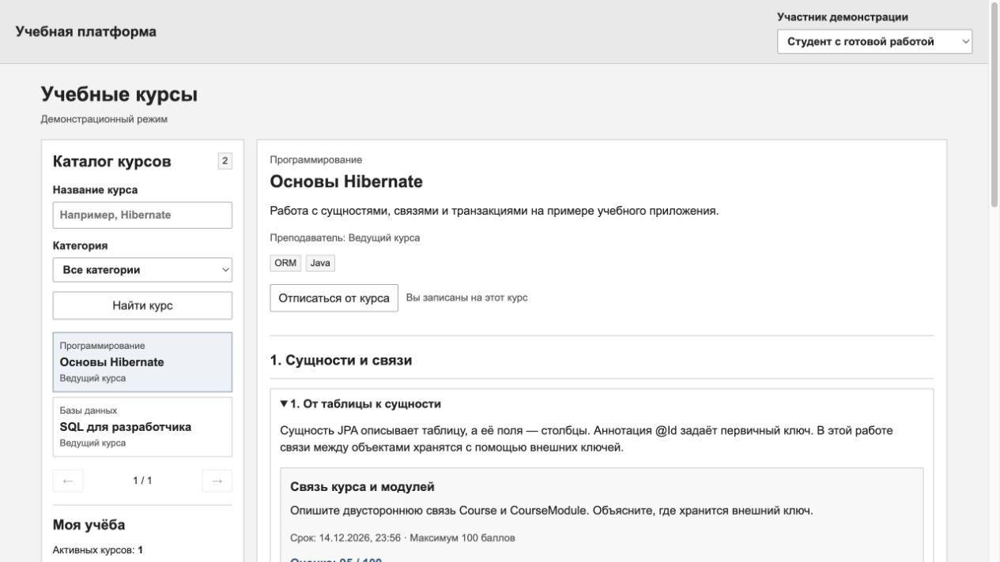

# Проверка проекта

Первую проверку провели 14–15 ноября 2026 года. Maven Wrapper запустил Maven 3.9.9. Для проверки использовались Temurin 21.0.6 и PostgreSQL 17.11 в Docker. Код компилировался с `release=17`.

## Тесты и сборка

Чтобы повторить сборку с очисткой `target`, выполните команду.

```bash
./mvnw clean verify
```

| Набор | Тестов |
|---|---:|
| `PlatformIntegrationTest` | 20 |
| `ApiIntegrationTest` | 9 |
| `LazyLoadingIntegrationTest` | 5 |
| `QuizGraderTest` | 10 |

```text
Tests run: 44, Failures: 0, Errors: 0, Skipped: 0
BUILD SUCCESS
```

Checkstyle не нашёл замечаний. Maven собрал `target/learning-platform-1.0.0.jar`. После правок интерфейса 22 ноября полный прогон `./mvnw test` снова прошёл с результатом 44 из 44.

### Что проверено

- Hibernate создаёт 15 таблиц сущностей и таблицу связи курсов с тегами. В тестах создаются, читаются, меняются и удаляются пользователи, профили, курсы и материалы.
- При сохранении курса сохраняются модуль и урок. При удалении курса исчезают его зависимые записи, а общие теги, категории и преподаватели остаются. Отдельный тест проверяет удаление данных одного студента.
- Тесты проверяют уникальность email, записей на курс, решений и отзывов. Можно записаться, отписаться, записаться снова и получить списки студентов и курсов.
- Задание принимает решение до дедлайна и отклоняет повторную сдачу. Тесты проверяют выставление оценки, редактирование теста, сохранение попыток и обработку вариантов из другого вопроса.
- В проверках REST сверяются ответы, коды ошибок, валидация и доступность файлов интерфейса. Отдельные тесты подтверждают, что JSON теста не раскрывает правильные ответы, а дедлайн со смещением сохраняется в UTC.
- Интеграционные тесты воспроизводят `LazyInitializationException`, затем проверяют загрузку через `EntityGraph` и чтение DTO. Для страницы курсов с разными преподавателями тест допускает не больше двух SQL-запросов.
- Юнит-тесты проверяют подсчёт полного и частичного результата, множественный выбор, пропуски и некорректные ответы.

## Запуск из исходников

Понадобится JDK 17 или новее. При первом запуске скопируйте `.env.example` в `.env` и поднимите PostgreSQL.

```bash
docker compose up -d --wait postgres
```

С настройками из примера сервер запускается так.

```bash
DB_URL=jdbc:postgresql://localhost:5433/learning_platform \
DB_USER=learning DB_PASSWORD=learning SERVER_PORT=8081 \
./mvnw spring-boot:run
```

В PowerShell задайте те же переменные через `$env:` и запустите `./mvnw.cmd spring-boot:run`. Если меняли порт или доступ к базе в `.env`, подставьте свои значения. Для своей PostgreSQL достаточно создать базу `learning_platform` и указать её JDBC URL, имя пользователя и пароль.

После `./mvnw verify` можно запустить собранный JAR с теми же переменными окружения.

```bash
java -jar target/learning-platform-1.0.0.jar
```

## Запуск и интерфейс

При запуске JAR с отдельной PostgreSQL Hibernate создал схему, а профиль `dev` заполнил её демоданными.

В браузере студент отправил работу и прошёл тест с одиночным и множественным выбором на 100%. Затем преподаватель выставил оценку, и после переключения обратно студент увидел балл и комментарий. Дедлайн задания 2 декабря в 23:59 по Москве API сохранил как `2026-12-02T20:59:00Z`. В консоли браузера ошибок JavaScript не было.

После упрощения интерфейса повторно проверены поиск, переключение ролей и открытие форм. Ниже снимок этой версии.



## Проверки Docker

Обе команды прошли на локальной ARM-платформе. `docker build --check` закончил проверку без предупреждений.

```bash
docker compose --profile app config --quiet
docker build --check .
```

На момент проверки в хранилище Docker кончилось место, поэтому полную сборку образа не запускали. Для тестов и ручного запуска PostgreSQL хранила данные в памяти.
